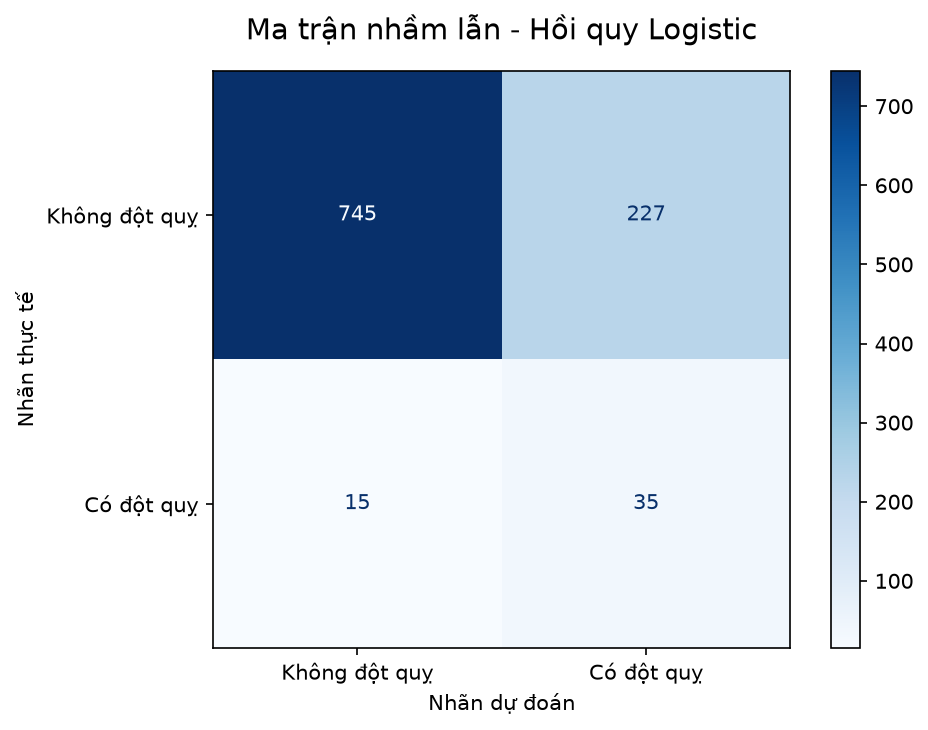
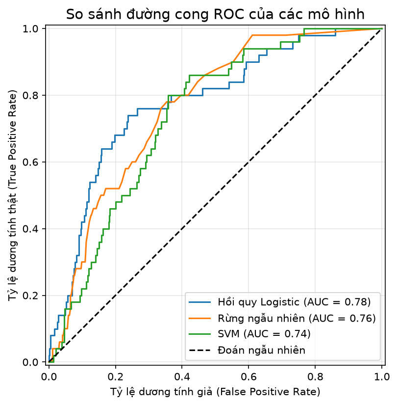
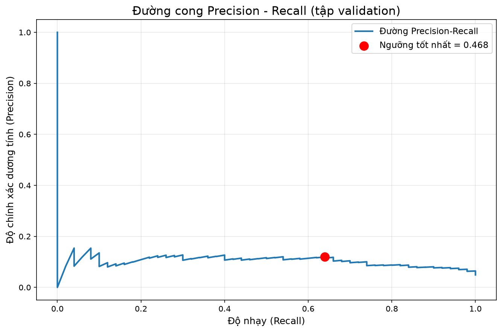
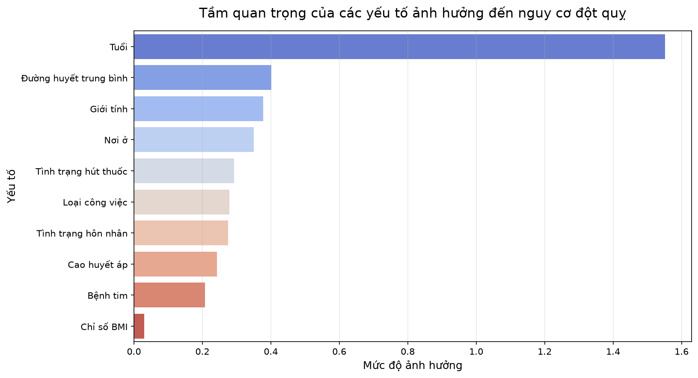

# Cerebra – Huấn luyện mô hình và API dự đoán (Python)

Phần học máy của **Cerebra**, đồ án môn Học máy: huấn luyện mô hình dự đoán nguy cơ đột quỵ từ dữ liệu y tế và cung cấp dịch vụ FastAPI để backend Go gọi tới.

> Kết quả chỉ mang tính tham khảo, không thay thế chẩn đoán y tế.

## Dữ liệu

- Bộ dữ liệu `healthcare-dataset-stroke-data.csv`, khoảng 5.110 bệnh nhân.
- Các cột: giới tính, tuổi, cao huyết áp, bệnh tim, đã kết hôn, loại công việc, nơi sống, đường huyết trung bình, BMI, tình trạng hút thuốc, và nhãn `stroke`.
- Dữ liệu mất cân bằng: chỉ khoảng 5% là ca đột quỵ.
- Tuổi lớn nhất trong dữ liệu là 82. Với tuổi cao hơn, mô hình phải ngoại suy và API trả thêm cảnh báo.

## Cấu trúc thư mục

```
train/
├── __pycache__/             # Tự sinh (không đưa lên Git)
├── .venv/                   # Môi trường ảo (không đưa lên Git)
├── charts/                  # Biểu đồ đánh giá do train.py tạo ra
│   ├── confusion_matrix.png
│   ├── evaluation_plots.png
│   ├── feature_importance.png
│   ├── precision_recall.png
│   └── roc_curve.png
├── api.py                   # Dịch vụ FastAPI: nạp model.joblib, nhận bệnh nhân, trả kết quả
├── model.joblib             # Mô hình đã huấn luyện (api.py nạp file này)
├── stroke_model_v2.pkl      # <Ghi chú: bản model nào, còn dùng không>
├── test.py                  # <Ghi chú: script gọi thử API>
├── train.py                 # Huấn luyện, đánh giá, lưu model.joblib
└── README.md
```

## Mô hình

- **Đặc trưng tự tạo:** nhóm tuổi, đánh dấu người cao tuổi, béo phì, đường huyết cao, số bệnh đi kèm, hút thuốc, và điểm nguy cơ tổng hợp.
- **Ensemble** gồm Logistic Regression, Random Forest và Gradient Boosting.
- **Chia dữ liệu:** 60% huấn luyện, 20% kiểm định, 20% kiểm tra (chia theo tầng để giữ tỉ lệ ca đột quỵ).
- **Kiểm định chéo 5 lớp** để chọn ngưỡng cảnh báo và ước lượng AUC ổn định hơn.
- **Hiệu chỉnh xác suất (Platt scaling)** vì `class_weight='balanced'` làm điểm thô cao hơn tỉ lệ thật. Model lưu cả bộ hiệu chỉnh và ngưỡng trong `model.joblib`.

### Kết quả chính

| Chỉ số | Giá trị |
|---|---|
| AUC kiểm định chéo | 0,843 ± 0,011 |
| AUC chỉ dùng tuổi (đối chứng) | 0,834 |
| Recall ở ngưỡng cảnh báo | khoảng 84% (khoảng tin cậy 71–92%) |
| Precision ở ngưỡng cảnh báo | khoảng 13% |

Số liệu có thể lệch nhẹ giữa các máy do khác phiên bản thư viện. Hãy lấy số liệu cuối cùng từ bảng mà `train.py` in ra trên máy của bạn.

### Hạn chế cần biết

- Tuổi chi phối gần hết tín hiệu: mô hình chỉ dùng tuổi đã đạt AUC gần bằng ensemble.
- Tập kiểm tra chỉ có khoảng 50 ca đột quỵ nên mọi chỉ số đều nhiễu.
- Con số trả về là **tỉ lệ ước lượng theo dữ liệu huấn luyện**, không phải rủi ro y khoa thật, vì dữ liệu không có mốc thời gian theo dõi.
- Ngưỡng cảnh báo ưu tiên không bỏ sót ca bệnh, đánh đổi bằng nhiều cảnh báo nhầm (precision thấp).
- Với hồ sơ cực đoan hoặc tuổi trên 82, điểm hiển thị tối đa chỉ quanh 61% vì các mô hình dạng cây không tăng thêm khi dữ liệu vượt vùng đã học.
- Đặc trưng `risk_score` do tự đặt trọng số.

## Mốc nhãn mức nguy cơ

`api.py` gán nhãn theo tỉ lệ ước lượng đã hiệu chỉnh:

| Tỉ lệ ước lượng | Nhãn |
|---|---|
| dưới 2% | THẤP |
| 2% đến dưới 5% | TRUNG BÌNH THẤP |
| 5% đến dưới 15% | TRUNG BÌNH |
| 15% đến dưới 30% | CAO |
| từ 30% trở lên | RẤT CAO |

Các mốc nằm trong khối `if/elif` của hàm `predict` ở `api.py`, đổi xong chỉ cần khởi động lại, không cần huấn luyện lại.

## Cài đặt

Yêu cầu: Python 3.10 trở lên (đã dùng Python từ python.org trên Windows).

```bash
python -m venv .venv
.venv\Scripts\activate
python -m pip install fastapi uvicorn pandas numpy scikit-learn joblib matplotlib
```

Nên ghim phiên bản để người khác cài lại giống hệt:

```bash
python -m pip freeze > requirements.txt
```

`scikit-learn` khi chạy phải **cùng phiên bản** với lúc huấn luyện ra `model.joblib`, nếu lệch có thể lỗi nạp model hoặc ra điểm khác.

## Huấn luyện

```bash
python train.py
```

Lệnh này đọc file CSV, huấn luyện, in bảng đánh giá, vẽ biểu đồ vào `charts/` và lưu `model.joblib`. Kiểm tra đường dẫn tới file CSV ở đầu `train.py` cho đúng với nơi bạn đặt dữ liệu.

Sau khi huấn luyện lại, cần commit file `model.joblib` mới và khởi động lại `api.py`, vì server chỉ nạp model một lần lúc khởi động. Nếu sửa hàm `add_features` ở `train.py` thì phải sửa **y hệt** ở `api.py`.

## Chạy API

```bash
python -m uvicorn api:app --port 8000
```

Trên Windows, nếu lệnh `python` chạy nhầm Python khác (ví dụ MSYS2), dùng đường dẫn trực tiếp: `.venv\Scripts\python.exe -m uvicorn api:app --port 8000`.

Thử nhanh không cần Go: mở `http://localhost:8000/docs` và gọi `POST /predict`.

### `POST /predict`

Nhận một bệnh nhân với các trường `gender`, `age`, `hypertension`, `heart_disease`, `ever_married`, `work_type`, `Residence_type`, `avg_glucose_level`, `bmi`, `smoking_status` (giá trị sai bị từ chối với lỗi 422) và trả về:

```json
{
  "probability": 22.8,
  "high_risk": true,
  "risk_level": "CAO",
  "advice": "Nguy cơ cao. Nên đi khám chuyên khoa sớm.",
  "factors": ["Tuổi cao (90 tuổi)", "Bị cao huyết áp", "Có bệnh tim"],
  "warning": "Tuổi vượt quá dữ liệu huấn luyện (tối đa 82), kết quả chỉ mang tính ước lượng."
}
```

## Biểu đồ đánh giá

| | |
|---|---|
|  |  |
|  |  |

## Các repo liên quan

| Phần | Repo | Cổng mặc định |
|---|---|---|
| Frontend (React) | `<link-repo-frontend>` | 5173 |
| Backend Go (Gin) | `<link-repo-backend>` | 8080 |
| Huấn luyện và API Python | `<link-repo-train>` | 8000 |

## Tác giả

- `Nhóm 12 - Trưởng nhóm: Nguyễn Minh Tiến - 2001240494`
- Môn: `Học máy` – Giảng viên: `TS.Phùng Thế Bảo`